# cysUML

<!-- mcp-name: io.github.yschoi9733/cysuml -->

An MCP server for document-ready UML diagrams: the AI lays them out, cysUML draws and checks them.

[한국어 안내](#한국어)

Auto-layout tools keep boxes apart, but they decide where everything goes: it is hard to get the arrangement you
want, one more class can reshuffle the whole picture, and labels can still crowd the lines. cysUML takes the other way
round: your AI assistant decides where every box goes, cysUML draws exactly that and checks the drawing. An assistant
placing boxes itself can get it wrong, so if boxes overlap, a line runs through a box or a label, or labels overlap,
the check fails and says what to move. The assistant fixes the layout and draws again until the check passes.

- Several kinds of UML diagram; the list is under [Use](#use). Sequence diagrams are laid out by cysUML from the order
  of participants and messages, and checked the same way.
- PNG output. The fonts are bundled, so every machine draws the same picture, Korean text included.

For example, here the assistant first put Product right under OrderLine, on the line from Customer to Payment. The
line then passes under the Product box, which hides it, and the picture says something the model doesn't: Product is
not related to Customer or Payment, yet it looks as if `pays` joined Customer to Product, and as if Product had its own
line to Payment. The check fails on exactly this and tells the assistant to move that box or change the line's bend
points:

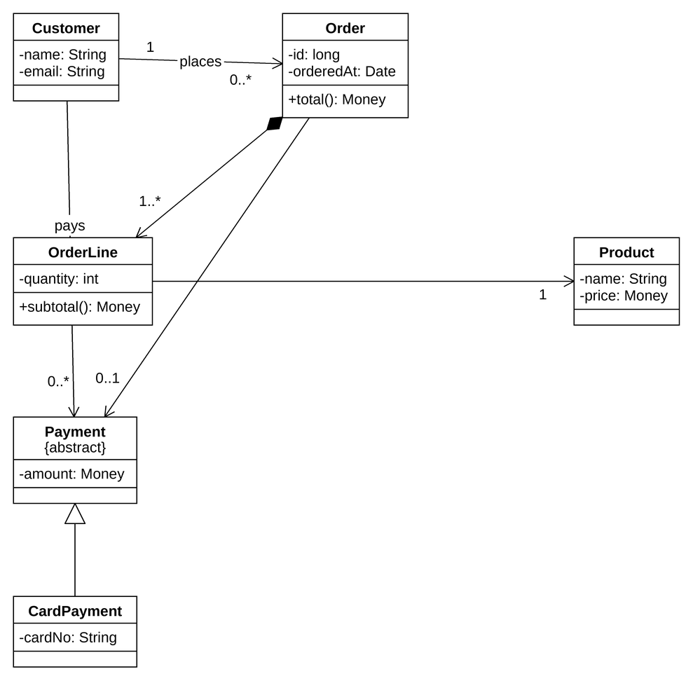

The assistant moved Product to the right of OrderLine, pulled Payment and CardPayment left into the room it left,
drew again, and the check passed:

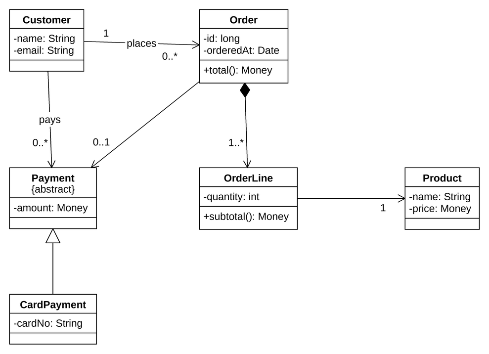

## Install

You need [uv](https://docs.astral.sh/uv/). This one line downloads cysUML from [PyPI](https://pypi.org/project/cysuml/)
and starts the server:

```
uvx cysuml
```

It talks MCP over stdin/stdout, so on its own it just waits for a client. Register it with your MCP client instead.

**Claude Code**

```
claude mcp add cysuml -- uvx cysuml
```

**Other clients** (Claude Desktop, Cursor, …) take the same command in their JSON config:

```json
{
  "mcpServers": {
    "cysuml": {
      "command": "uvx",
      "args": ["cysuml"]
    }
  }
}
```

**Versions.** `uvx cysuml` runs the newest release: each time the client starts the server, uv asks PyPI and reuses
the answer for up to ten minutes. If you installed it with `uv tool install cysuml`, uvx runs that copy instead;
update it with `uv tool upgrade cysuml`. To stay on one version, put it after the name: `uvx cysuml@0.2.1` (in JSON,
`"args": ["cysuml@0.2.1"]`). The releases are listed in the [release history](https://pypi.org/project/cysuml/#history).

## Use

Ask your assistant for a diagram, for example "draw a class diagram of the order domain with cysUML" or "draw the
checkout flow as a sequence diagram with cysUML". The server tells the assistant how to lay it out, so you don't
have to.

### Class diagrams

The tool is `draw_class_diagram`. The assistant sends boxes with their top-left corners and relations with
optional bend points:

```json
{
  "file_name": "order",
  "classes": [
    {"name": "Order", "left": 0, "top": 0, "attributes": ["-id: long"]},
    {"name": "Customer", "left": 200, "top": 0}
  ],
  "relations": [
    {"kind": "association", "from": "Order", "to": "Customer", "name": "places", "to_multiplicity": "1"}
  ]
}
```

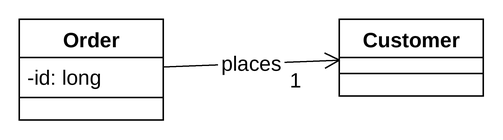

It gets back the check result, the size and place of every box as drawn, the saved file paths, and the picture.
The check **fails** when boxes overlap, a line runs through a box, a label or another line's arrowhead, or labels
overlap. A relation's name is drawn on top of that relation's line, which breaks around the name, so the stretch of
line it sits on doesn't count as running through it (the rest of that line, its end shapes and other lines still do).
A name with no room on its line (including a line too short to stay visible on both sides of the name), or on a line
that loops back to the same box, goes beside the line, and if putting the names on their lines makes the whole picture
fail more, every name goes beside its line.
Crossing lines and the picture size are reported but don't fail. Inheritance lines from several children to
one parent may join into one trunk that shares a single triangle (realization lines too, but not mixed with
inheritance); the `relations` argument description tells the assistant how to give the bend points for it. When both
kinds come to one parent, the result lists a point for each kind either side of the point the parent's lines aim at
(usually its middle); a line whose last bend point sits right below its kind's point goes straight up to it, so the
two triangles sit side by side. A parent too narrow for two triangles (a class drawn narrower than 48px, or in the
package, component and deployment tools an icon-style artifact) gets no points.

Relations must follow UML notation, and the tool rejects the input otherwise: a generalization joins two boxes of the
same kind (a class and an abstract class count as one kind), never runs in a cycle, and neither a generalization nor a
realization points back to its own box. A realization made by an interface, or one that ends on something other than
an interface, is drawn and reported as a notice. The package, component and deployment tools follow the same rules.
There a package or a provided interface ball is never an end of a generalization, a realization made by either of
them gets a notice, and a realization from a class to a component (the class realizes the component) does not. Icon
notations of components and artifacts count as the same kind as the plain ones.

### Package diagrams

The tool is `draw_package_diagram`. It draws packages and the dependencies between them, with classes and packages
inside packages, and takes components, artifacts and nodes in the same picture. Every element has a `kind`. An element
names the one it sits in with `in`, and the outer element grows right and down to cover it:

```json
{
  "file_name": "packages",
  "elements": [
    {"kind": "package", "name": "web", "left": 0, "top": 0},
    {"kind": "class", "name": "OrderController", "in": "web", "left": 20, "top": 44},
    {"kind": "package", "name": "domain", "left": 0, "top": 180},
    {"kind": "class", "name": "Order", "in": "domain", "left": 20, "top": 224},
    {"kind": "class", "name": "Customer", "in": "domain", "left": 200, "top": 224}
  ],
  "relations": [
    {"kind": "dependency", "from": "web", "to": "domain", "stereotype": "use"},
    {"kind": "association", "from": "Order", "to": "Customer", "name": "places", "to_multiplicity": "1"}
  ]
}
```

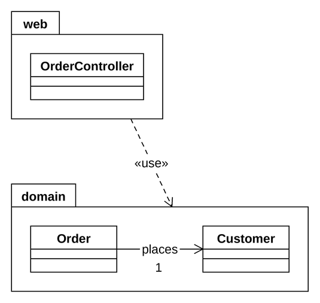

It gets back the same things as the class diagram tool, with the place of every element (and, for a package, the
point its lines aim at, since that is not the middle of the package). Besides the class diagram
checks, the check fails when an element inside another sits too close to its edge or name tab, or a line runs along
the edge of a package it starts or ends in, or through a package's name tab.

Components and artifacts can also be drawn in icon notation. `component_icon` is the UML 1 component: a box with two
small rectangles across its left edge, which lines may not cross. `artifact_icon` is a folded-page icon with the name
(often a file name) outside it, on the side `name_side` gives.

### Component diagrams

The tool is `draw_component_diagram`. It draws components with the interfaces they provide, the artifacts that
implement them, and the classes that realize them. It takes every element of the package diagram tool (icon notations included), plus
`lollipop`: a provided interface drawn as a small circle with its name outside (`name_side` puts the name below,
above, left or right of the circle). The providing component joins the circle with an `association`, drawn without
an arrowhead in this tool unless `navigable` is given, and each user points at the circle with a `dependency`:

```json
{
  "file_name": "components",
  "elements": [
    {"kind": "package", "name": "web", "left": 0, "top": 0},
    {"kind": "component", "name": "OrderController", "in": "web", "left": 20, "top": 44},
    {"kind": "component", "name": "AdminController", "in": "web", "left": 220, "top": 44},
    {"kind": "package", "name": "service", "left": 0, "top": 220},
    {"kind": "component", "name": "OrderService", "in": "service", "left": 110, "top": 324},
    {"kind": "lollipop", "name": "OrderApi", "in": "service", "left": 70, "top": 264, "name_side": "left"},
    {"kind": "artifact", "name": "order-service.jar", "left": 400, "top": 324}
  ],
  "relations": [
    {"kind": "association", "from": "OrderService", "to": "OrderApi"},
    {"kind": "dependency", "from": "OrderController", "to": "OrderApi"},
    {"kind": "dependency", "from": "AdminController", "to": "OrderApi"},
    {"kind": "dependency", "from": "order-service.jar", "to": "OrderService", "stereotype": "manifest"}
  ]
}
```

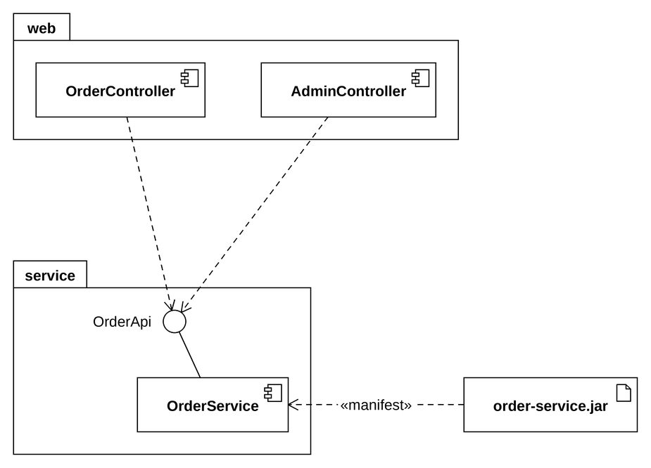

It gets back the same things as the package diagram tool, and for each circle the place of the circle alone next to
the place of the circle with its name. The checks are the same: a line through a circle or its name fails.

A user of an interface can also be drawn as a socket. A `requires` relation from the user to the circle is a solid
line that stops short of the circle and ends in a half circle wrapped around it (ball and socket). Its `to` must be a
`lollipop` and its `from` must not be one. A circle takes one socket, since two half circles overlap, so any other
user points at the circle with a `dependency`. A line that touches a half circle fails. With the icon notations,
the same tool draws a textbook-style picture of UML 1 components and folded-page artifacts:

```json
{
  "file_name": "billing",
  "elements": [
    {"kind": "artifact_icon", "name": "Billing.exe", "left": 38, "top": 0, "name_side": "right"},
    {"kind": "component_icon", "name": "Billing", "left": 0, "top": 110},
    {"kind": "lollipop", "name": "IBilling", "left": 190, "top": 124},
    {"kind": "component_icon", "name": "Register", "stereotype": "component", "left": 320, "top": 103},
    {"kind": "component_icon", "name": "Course", "left": 0, "top": 260},
    {"kind": "artifact_icon", "name": "Course.dll", "left": 24, "top": 380}
  ],
  "relations": [
    {"kind": "dependency", "from": "Billing.exe", "to": "Billing", "stereotype": "manifest"},
    {"kind": "association", "from": "Billing", "to": "IBilling"},
    {"kind": "requires", "from": "Register", "to": "IBilling"},
    {"kind": "dependency", "from": "Register", "to": "Course", "via": [[385, 284]]},
    {"kind": "dependency", "from": "Course.dll", "to": "Course", "stereotype": "manifest"}
  ]
}
```

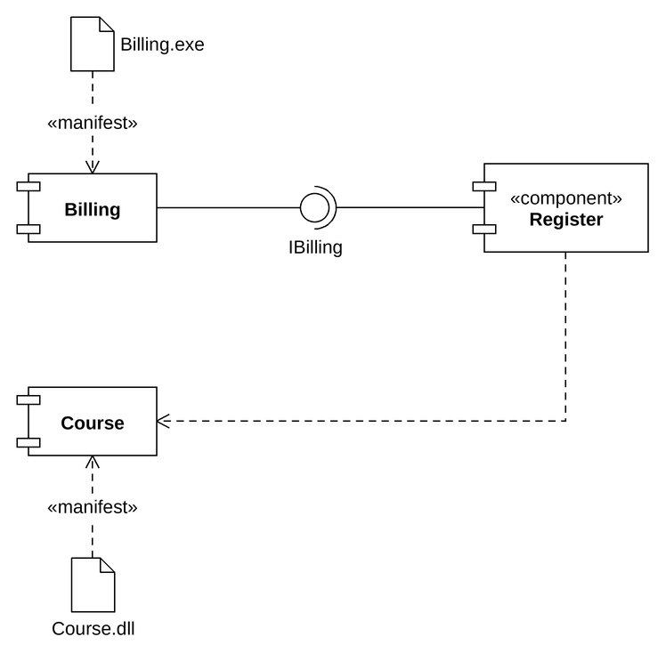

### Deployment diagrams

The tool is `draw_deployment_diagram`. It shows which computers (nodes) the software runs on: components and
artifacts sit inside nodes with `in`, and a node can sit inside another node. It takes the same elements as the package
diagram tool, icon notations included. A communication path between nodes is an `association` with the protocol as its `name`. This tool draws
every association without an arrowhead (between classes too) unless `navigable` says otherwise. A «deploy» arrow from
an element outside a node is a `dependency` with `"stereotype": "deploy"`:

```json
{
  "file_name": "deployment",
  "elements": [
    {"kind": "node", "name": "PC", "stereotype": "device", "left": 0, "top": 0, "height": 220},
    {"kind": "component", "name": "Browser", "in": "PC", "left": 20, "top": 66},
    {"kind": "node", "name": "App Server", "stereotype": "device", "left": 240, "top": 0, "height": 220},
    {"kind": "node", "name": "Tomcat", "stereotype": "executionEnvironment", "in": "App Server", "left": 260, "top": 66},
    {"kind": "component", "name": "OrderService", "in": "Tomcat", "left": 280, "top": 132},
    {"kind": "node", "name": "DB Server", "stereotype": "device", "left": 620, "top": 0, "height": 220},
    {"kind": "artifact", "name": "orders.db", "in": "DB Server", "left": 640, "top": 66},
    {"kind": "artifact", "name": "order.war", "left": 310, "top": 280}
  ],
  "relations": [
    {"kind": "association", "from": "PC", "to": "App Server", "name": "HTTPS"},
    {"kind": "association", "from": "App Server", "to": "DB Server", "name": "JDBC"},
    {"kind": "dependency", "from": "order.war", "to": "Tomcat", "stereotype": "deploy"}
  ]
}
```

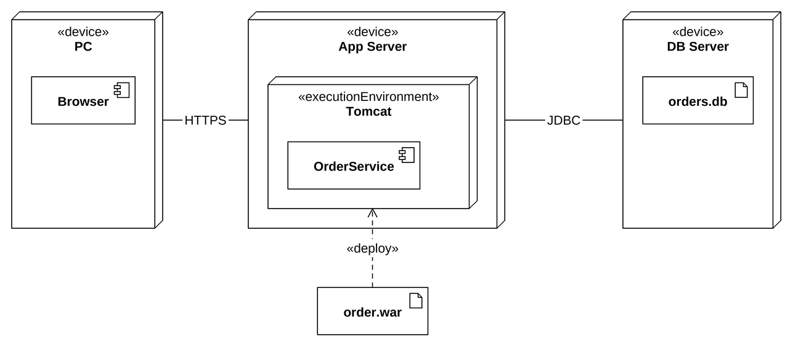

It gets back the same things as the package diagram tool, and the check fails in the same cases, such as a
communication path running through a node it does not connect or through an element inside one.

### Use case diagrams

The tool is `draw_use_case_diagram`. It draws actors, use cases and the system boundary, joined by associations,
«include» and «extend» dependencies, and generalizations. Use cases sit inside the system boundary with `in`. Actors
stand outside it and write their name beside the figure, on the side `name_side` gives:

```json
{
  "file_name": "use-cases",
  "elements": [
    {"kind": "system", "id": "shop", "name": "Online shop", "left": 160, "top": 0},
    {"kind": "use_case", "name": "Browse items", "in": "shop", "left": 200, "top": 50},
    {"kind": "use_case", "name": "Place order", "in": "shop", "left": 200, "top": 150},
    {"kind": "use_case", "name": "Pay", "in": "shop", "left": 420, "top": 150},
    {"kind": "actor", "name": "Customer", "left": 0, "top": 130, "name_side": "left"},
    {"kind": "actor", "name": "Bank", "left": 660, "top": 157, "name_side": "right"}
  ],
  "relations": [
    {"kind": "association", "from": "Customer", "to": "Browse items"},
    {"kind": "association", "from": "Customer", "to": "Place order"},
    {"kind": "dependency", "from": "Place order", "to": "Pay", "stereotype": "include"},
    {"kind": "association", "from": "Pay", "to": "Bank"}
  ]
}
```

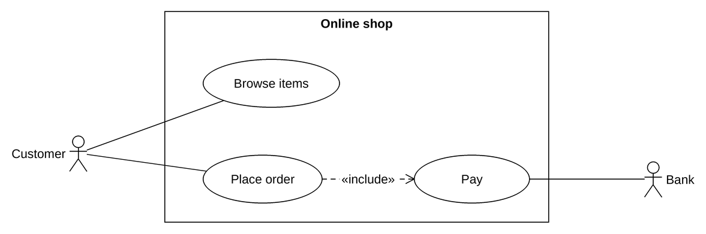

It gets back the same things as the package diagram tool. An actor's place covers the figure and its name, and the
figure's own place comes after it. The check is the same as for package diagrams, and it also fails when a line runs
through an actor's name or the name at the top of the system boundary. Generalization lines to one parent may share
one trunk, as inheritance lines do in class diagrams.

Elements and relations must follow UML notation, and the tool rejects the input otherwise. An actor stays outside the
system boundary, and no relation of any kind ends on the system boundary. An association joins an actor and a use
case, or two use cases whose boundaries differ (different boundaries, or one inside a boundary and one outside); it
never joins two actors, two use cases of the same boundary, or two use cases both outside any boundary. A
generalization joins two actors or two use cases and never runs in a cycle or back to itself. «include» and «extend»
go only on dependencies between use cases; a use case never includes or extends itself, and neither includes nor
extends run in a cycle.

### State diagrams

The tool is `draw_state_diagram`. It draws start and end points, states and choice diamonds joined by transitions. A
state lists its `entry /`, `do /` and `exit /` lines in `actions`, written as given, and can hold other states with
`in`. Start and end points and choices have no name, so they get an `id` for transitions to point to. The transition
`name` is written as given too, brackets and slash included:

```json
{
  "file_name": "order-states",
  "elements": [
    {"kind": "initial", "id": "start", "left": 85, "top": 0},
    {"kind": "state", "name": "Waiting", "left": 25, "top": 60, "width": 140},
    {"kind": "state", "name": "Checking", "left": 25, "top": 180, "width": 140,
     "actions": ["entry / reserve stock", "do / wait for payment"]},
    {"kind": "final", "id": "end", "left": 83, "top": 340}
  ],
  "relations": [
    {"from": "start", "to": "Waiting"},
    {"from": "Waiting", "to": "Checking", "name": "order [in stock] / accept"},
    {"from": "Waiting", "to": "Waiting", "name": "tick", "via": [[190, 68], [190, 92]]},
    {"from": "Checking", "to": "end", "name": "paid"}
  ]
}
```

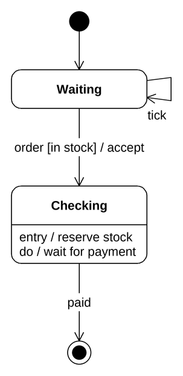

It gets back the same things as the package diagram tool. The check also fails when a line runs through the name and
actions of a state it starts or ends in, or a label sits on them.

### Activity diagrams

The tool is `draw_activity_diagram`. It draws start and end points, actions, and decision and merge diamonds joined
by flows. The guard of a flow out of a decision goes in its `name`, brackets included:

```json
{
  "file_name": "order-flow",
  "elements": [
    {"kind": "initial", "id": "start", "left": 140, "top": 0},
    {"kind": "action", "name": "Take order", "left": 95, "top": 60, "width": 110},
    {"kind": "decision", "id": "stock?", "left": 135, "top": 150},
    {"kind": "action", "name": "Ship", "left": 0, "top": 230},
    {"kind": "action", "name": "Restock", "left": 200, "top": 230},
    {"kind": "merge", "id": "done?", "left": 135, "top": 320},
    {"kind": "final", "id": "end", "left": 138, "top": 400}
  ],
  "relations": [
    {"from": "start", "to": "Take order"},
    {"from": "Take order", "to": "stock?"},
    {"from": "stock?", "to": "Ship", "name": "[in stock]", "via": [[45, 165]]},
    {"from": "stock?", "to": "Restock", "name": "[out of stock]", "via": [[245, 165]]},
    {"from": "Ship", "to": "done?", "via": [[45, 335]]},
    {"from": "Restock", "to": "done?", "via": [[245, 335]]},
    {"from": "done?", "to": "end"}
  ]
}
```

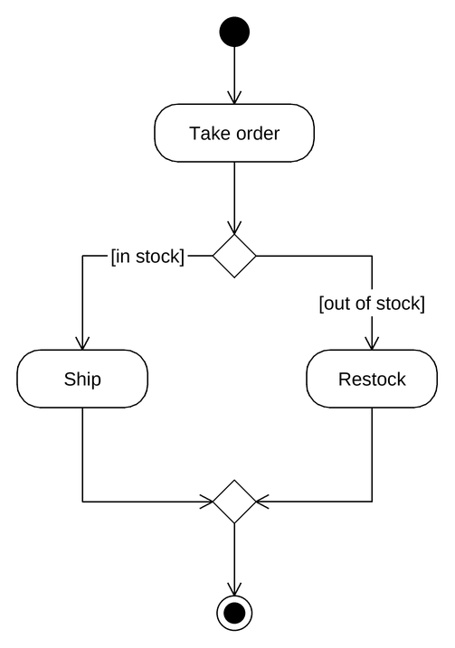

It gets back the same things as the package diagram tool, and checks the same way.

### Sequence diagrams

The tool is `draw_sequence_diagram`. The assistant sends no coordinates: only the participants, the messages in
order, frames (`loop`, `opt`, `alt`) that cover a range of messages, and `ref` boxes placed before a message.
cysUML spaces the lifelines to fit the text and draws the activation bars:

```json
{
  "file_name": "checkout",
  "participants": [{"name": "Customer", "kind": "actor"}, {"name": "Shop"}, {"name": "Payment"}],
  "messages": [
    {"from": "Customer", "to": "Shop", "name": "order()"},
    {"from": "Shop", "to": "Payment", "name": "pay(amount)"},
    {"from": "Payment", "to": "Shop", "kind": "reply", "name": "receipt"},
    {"from": "Shop", "to": "Customer", "kind": "reply"}
  ],
  "frames": [{"kind": "opt", "first": 1, "last": 2, "condition": "paid by card"}]
}
```

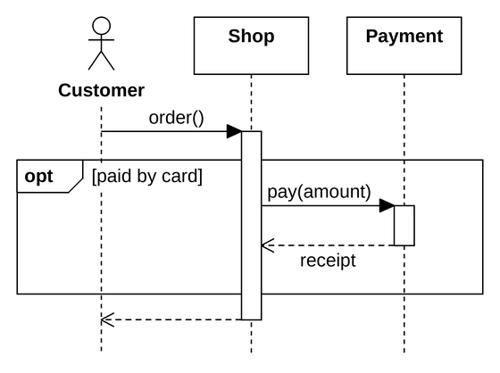

It gets back the check result, the saved file paths, and the picture. As cysUML does the layout, a failed check is a
cysUML bug. Each finding still says what to change in the input to get around it: the order of participants or
messages, the messages a frame covers, shorter text, or splitting the diagram.

### All tools

- **Saved to** `out_dir`, or `diagrams/` under the server's working folder when `out_dir` is not given. The same
  `file_name` overwrites the picture and its input file (below). Some clients start servers in a folder you can't
  write to (such as `/`); the tool then answers with an error, and the assistant should pass an `out_dir`.
- **Input file** `<file_name>.cysuml.json` is saved next to the picture: the tool name and the input that drew it,
  without `out_dir`. To change a diagram later, the assistant reads that file, edits it, and draws it again with
  `out_dir` set to the file's folder; the file as it is draws the same picture. The `.cysuml.json` ending keeps it apart
  from other tools' files such as `package.json`.
- **Returned picture** is shrunk to 1568 px on its long side when it is bigger. The saved picture keeps its full size.

The full input format is in each tool's argument descriptions, which your client hands to the assistant.

### Choosing a model

Four Claude models were given 26 diagrams of 7 kinds (2–36 elements) with every position removed, and each drew until
the check passed (at most 10 draws). One run is one diagram drawn until it passes or stops. Sequence diagrams were left
out, as cysUML lays them out itself. Effort was varied too: how much the model thinks before it answers, which Claude
Code sets with `--effort` (not every client lets you set it).

A draw counts as a pass only if it passes the check and still draws the diagram as given. 11 of the 606 draws that
passed the check had changed the diagram instead, for example by removing every arrowhead with `navigable: none` or by
dropping a state's actions; in one run the model then drew it again as given and passed. In all, 15 of 609 runs did
not pass: 10 because of such a change, 4 with Haiku at low or medium effort (one of them passed only after the 10-draw
limit), and 1 with Fable that hit the cost limit set on each run. Every model passed each of the 26 diagrams at least
once, except Haiku on one diagram that was run only once.

The models differ in how many draws they need, and in how often the first picture they draw already passes. At high
effort:

| Model | Passed on the first draw | Average draws to pass | Average cost per run |
|---|---|---|---|
| Claude Haiku 5.5 | 25 of 66 runs | 1.2–2.5 | $0.003–0.11 |
| Claude Sonnet 5.5 | 26 of 60 runs | 1.2–2.4 | $0.04–0.63 |
| Claude Opus 5.5 | 41 of 60 runs | 1.2–1.4 | $0.08–1.34 |
| Claude Fable 5.2 | 52 of 60 runs | 1.1–1.2 | $0.14–2.41 |

The left end of each range is for diagrams of 2–8 elements, the right end for 31–36 elements. Average draws count only
the runs that passed. At high effort, each model ran the 9 diagrams in this README once (the before-and-after
pictures at the top and their Korean versions count as one diagram, and the sequence diagram is left out) and 17 larger
ones three times (60 runs); Haiku ran each of the three largest twice more (66). With the low- and medium-effort runs,
that makes 609. Most diagrams ran three times per model and effort, so small differences may be chance.

- To keep costs low, use Haiku 5.5 at high effort. It passed 63 of 66 runs (the 3 misses changed the diagram) but
  redrew the most; lower effort cost about the same and failed 4 runs.
- If every run must draw the diagram as given, use Opus 5.5 at high effort: it passed all 60 runs and never changed a
  diagram.
- If passing on the first draw matters most, use Fable 5.2: it did so most often. At medium effort it cost about half
  as much and, on diagrams of 11–23 elements, still passed on the first draw more often than Opus 5.5 at high effort,
  which cost about the same. Above 30 elements, Opus 5.5 at medium effort matched Fable 5.2 at high effort (6 of 9 on
  the first draw) for less than half the cost ($0.73 vs $2.41 a run). On those diagrams, Fable 5.2's high-effort average ($2.41) includes
  two runs that went over the cost limit, one of them the failed run above; without them it is $1.67, still more than
  twice the $0.73 of Opus 5.5 at medium effort.

Measured with cysUML 0.2.1 and Claude Code on 2026-11-18, at Claude API prices; other clients or subscription plans may
cost differently. Only Claude models were measured. The runs did not block effort set in the shell or in settings files
and did not log the effort used; for every model, run times rise with each effort level, so the `--effort` flag appears
to have applied. The method, the low- and medium-effort tables, run times, and the
commands to measure again are in
[`bench/RESULTS.md`](https://github.com/yschoi9733/cysUML/blob/main/bench/RESULTS.md) (in Korean).

## Develop

```
uv sync
uv run pytest
```

To try your working copy in Claude Code, register it under another name:

```
claude mcp add cysuml-dev -- uv run --directory /path/to/cysUML cysuml
```

To try the latest `main` before it is released, use `uvx --from git+https://github.com/yschoi9733/cysUML cysuml`.

The pictures in this README live in `docs/images/` and are drawn with `uv run python scripts/readme_images.py`. The
example pictures under [Use](#use) are drawn from the JSON examples above, so run it after changing one. The
before/after pictures at the top are drawn from their input files, `docs/images/first-try.cysuml.json` and the like:
edit those, then run it.

## License

cysUML is under the [MIT License](https://github.com/yschoi9733/cysUML/blob/main/LICENSE). The bundled fonts are
Liberation Sans and Noto Sans KR, both under the SIL Open Font License 1.1 (see
[`LiberationSans-LICENSE.txt`](https://github.com/yschoi9733/cysUML/blob/main/src/cysuml/fonts/LiberationSans-LICENSE.txt)
and [`NotoSansKR-LICENSE.txt`](https://github.com/yschoi9733/cysUML/blob/main/src/cysuml/fonts/NotoSansKR-LICENSE.txt)).

---

## 한국어

AI가 배치하고 도구가 그리는, 문서용 UML 그림 MCP 서버다.

자동 배치 도구는 상자끼리 겹치지 않게 놓아 주지만, 자리를 도구가 정한다. 원하는 모양으로 놓게 하기 어렵고, 클래스 하나만 더해도
그림 전체가 뒤섞일 수 있고, 글자가 선에 붙어 어수선해지기도 한다. cysUML은 반대로 간다. AI 어시스턴트가 상자 자리를 정하면
cysUML은 그대로 그리고 그림을 검사한다. 어시스턴트가 자리를 직접 잡다 보면 실수가 생기므로, 상자끼리 겹치거나, 선이 상자나
글자를 지나거나, 글자끼리 겹치면 불합격이고 무엇을 옮길지 알려 준다. 어시스턴트는 배치를 고쳐 합격할 때까지 다시 그린다.

- 여러 UML 그림을 그린다(목록은 아래 [쓰기](#쓰기)). 교류도는 참여자·메시지 차례를 받아 cysUML이 배치하고, 똑같이 검사한다.
- PNG로 낸다. 글꼴을 함께 넣어 어느 컴퓨터에서든 같은 그림이 나오고, 한글도 그린다.

예를 들어 어시스턴트가 처음에 상품을 주문항목 바로 아래, 고객과 결제를 잇는 선 위에 두면, 그 선이 상품 상자 밑으로 지나가
가려진다. 그러면 그림이 모델에 없는 것을 말한다 — 상품은 고객·결제와 관계가 없는데, `낸다`가 고객과 상품 사이의 관계처럼
보이고 상품에서 결제로 가는 선이 따로 있는 것처럼 보인다. 검사는 바로 이 한 건으로 불합격시키고 이렇게 알려 준다.

> 선이 상자를 지난다: 선 고객->결제(relations[3]), 상자 상품(190, 240, 130×93). 그 상자를 옮기거나, 꺾는 점(via)을 고쳐 그 상자를 비켜 가게 한다.

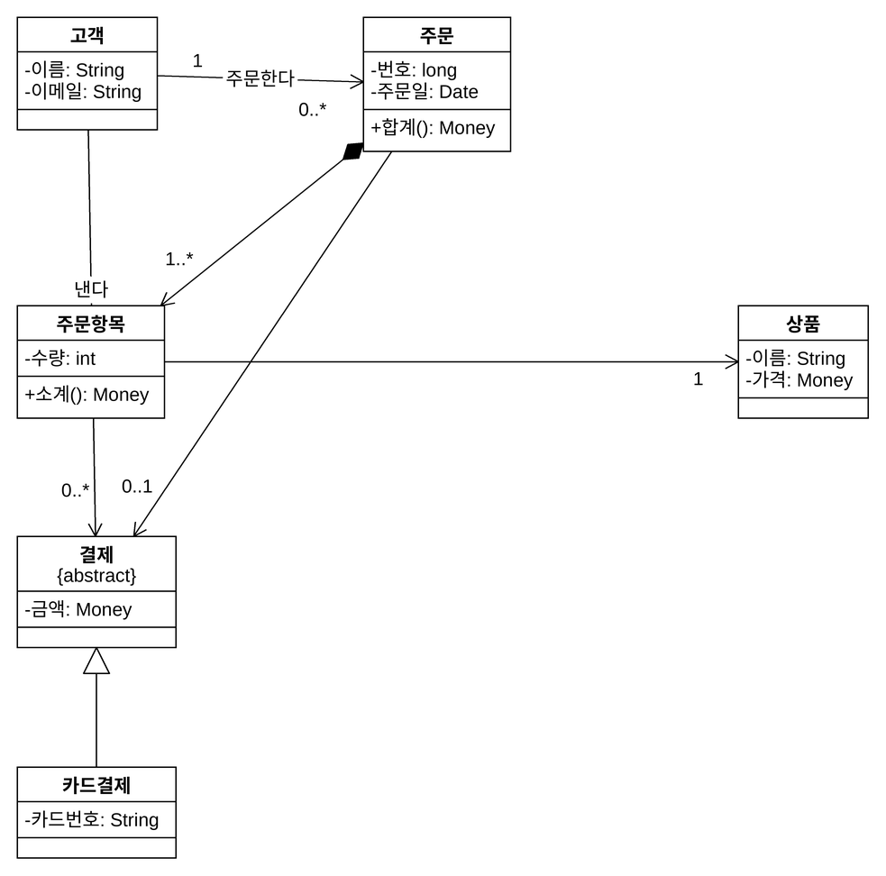

어시스턴트가 알려 준 대로 상품을 주문항목 오른쪽으로 옮기고, 빈자리만큼 결제와 카드결제를 왼쪽으로 당겨 다시 그리자 검사를
통과했다.

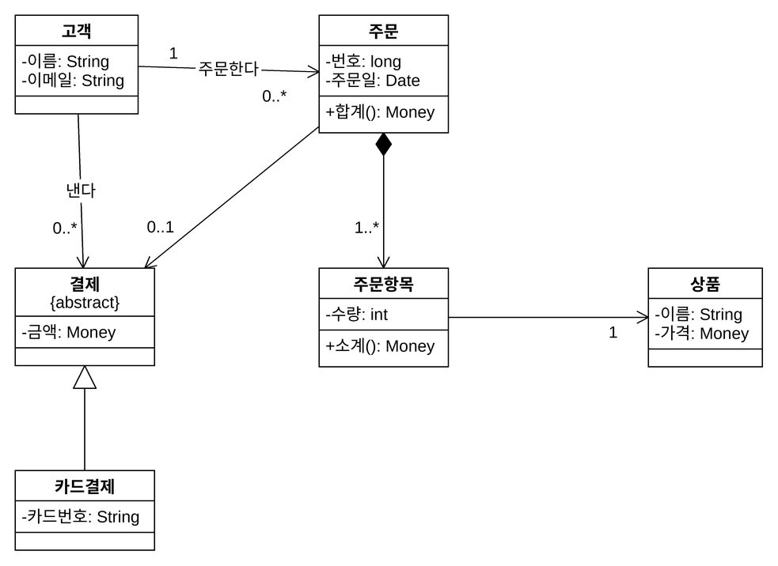

### 설치

[uv](https://docs.astral.sh/uv/)가 있어야 한다. 아래 한 줄이 [PyPI](https://pypi.org/project/cysuml/)에서 cysUML을 받아
서버를 띄운다:

```
uvx cysuml
```

표준 입출력으로 MCP를 주고받으므로 혼자 띄우면 클라이언트를 기다리기만 한다. 쓰려면 MCP 클라이언트에 등록한다.

- **Claude Code:** `claude mcp add cysuml -- uvx cysuml`
- **다른 클라이언트:** 위 영어 안내의 JSON 설정에 같은 명령을 넣는다.
- **버전:** `uvx cysuml`은 가장 새 버전을 띄운다. 클라이언트가 서버를 띄울 때마다 uv가 PyPI에 묻고, 받은 답은 10분까지 다시
  쓴다. `uv tool install cysuml`로 설치해 두었으면 uvx는 그 설치본을 띄우니 `uv tool upgrade cysuml`로 올린다. 한 버전에
  머물려면 이름 뒤에 버전을 붙인다 — `uvx cysuml@0.2.1`(JSON에서는 `"args": ["cysuml@0.2.1"]`). 나온 버전은
  [PyPI 릴리스 기록](https://pypi.org/project/cysuml/#history)에 있다.

### 쓰기

어시스턴트에게 "cysUML로 주문 도메인 클래스도를 그려 줘"나 "결제 흐름을 cysUML 교류도로 그려 줘"처럼 부탁한다. 배치 요령은
서버가 어시스턴트에게 알려 준다.

- **클래스도**는 `draw_class_diagram`으로 그린다. 어시스턴트가 상자의 왼쪽 위 자리와, 필요하면 관계선의 꺾는 점을 준다. 결과로
  검사 결과, 상자마다 그린 자리와 크기, 저장한 그림·입력 파일 경로, 그림을 돌려준다. 상자끼리 겹치거나, 선이 상자·글자·다른 선의 화살촉을
  지나거나, 글자끼리 겹치면 불합격이다. 관계 이름은 그 관계의 선 위에 얹어 그리고(선은 이름 앞뒤에서 끊긴다), 이름이 얹힌 그 선
  구간은 이름을 지나는 것으로 치지 않는다(같은 선의 다른 구간·선 끝 모양과 다른 선은 친다). 선 위에 빈 자리가 없거나(선이 짧아
  이름 앞이나 뒤에 선이 거의 보이지 않을 때도) 같은 상자로 돌아오는 선의 이름은 선 옆에 두고, 얹으면 그림 전체에서 걸리는 곳이
  더 많아질 때는 모든 이름을 선 옆에 둔다. 선끼리 엇갈린 곳과 그림 크기는 알려 주기만 하고 불합격이 아니다. 같은 부모로 가는
  상속끼리, 실체화끼리는 여러 선을 한 줄기로 모아 삼각형 하나를 함께 써도 된다(꺾는 점을 주는 법은 `relations` 인자 설명에 있다). 같은
  부모로 상속과 실체화가 함께 오면 결과가 부모에서 선이 향하는 점(보통 가운데) 양옆에 종류마다 향하는 점을 함께 돌려주고,
  마지막 꺾는 점을 그 선과 같은 종류의 점 바로 아래에 둔 선은 그 점으로 곧게 올라가 두 삼각형이 나란히 놓인다. 삼각형 둘이
  나란히 들지 않는 좁은 부모(48px보다 좁게 그려진 클래스, 다른 도구의 문서 아이콘 아티팩트)에는 점이 붙지 않는다. 관계는
  UML 표기를 따라야 하고, 어기면 그리지 않고 입력 오류로 돌려준다 — 상속은 같은 종류끼리(클래스와 추상 클래스는 같은 종류)
  긋고, 고리를 이루거나 자기 자신으로 가는 상속·실체화는 받지 않는다. 인터페이스가 하는 실체화와 인터페이스가 아닌 것으로 가는
  실체화는 그리되 알림을 준다. 패키지도·컴포넌트도·배치도(deployment diagram)도 같은 규칙을 쓴다. 거기서 패키지와 제공
  인터페이스 원은 상속의 끝이 될 수 없고, 둘이 하는 실체화에는 알림을 주며, 클래스가 컴포넌트를 실현하는 실체화에는 알림을 주지
  않는다. 아이콘 표기 컴포넌트·아티팩트는 기본 표기와 같은 종류로 친다.
- **패키지도**는 `draw_package_diagram`으로 그린다. 패키지와 패키지 사이 의존을 그리고, 패키지 안에 클래스·패키지를 넣는다.
  컴포넌트·아티팩트·노드도 한 그림에 함께 그린다. 요소마다 `kind`를 주고, 다른 요소 안에 둘 요소는 `in`으로 품은 요소를
  가리킨다 — 바깥 요소는 안의 요소를 덮도록 오른쪽·아래로 늘어난다. 결과는 클래스도와 같고 요소마다 그린 자리를 돌려준다(패키지는
  선이 가운데가 아니라 탭 오른쪽 몸통의 가운데를 향하므로 그 점도 함께).
  클래스도 검사에 더해, 안의 요소가 바깥 요소의 테두리·이름 탭에 붙거나, 선이 그 끝을 품은 패키지의 테두리를 따라가거나 패키지
  탭을 지나면 불합격이다. 컴포넌트·아티팩트는 아이콘 표기로도 그린다 — `component_icon`은 왼쪽 변에 작은 네모 둘이 걸친 UML 1
  표기 컴포넌트(선이 네모를 지나면 불합격), `artifact_icon`은 귀 접힌 문서 아이콘과 그 밖(`name_side`)에 쓰는 이름이다.
- **컴포넌트도**는 `draw_component_diagram`으로 그린다. 컴포넌트와 제공 인터페이스, 컴포넌트를 구현하는 아티팩트, 컴포넌트를
  실현하는 클래스를 그린다. 패키지도 도구가 받는 요소(아이콘 표기 포함)에 더해 `lollipop`(제공 인터페이스 원 — 작은 원과 그 밖에 쓰는
  이름으로 그린다. 이름 쪽은 `name_side`)을 받는다. 제공하는 컴포넌트는 원과 `association`으로 잇고(이 도구에서는 `navigable`을
  주지 않으면 화살촉이 없다), 쓰는 쪽은 원으로 `dependency`를 긋는다. 결과는 패키지도와 같고, 원마다 원만의 자리도 함께
  돌려준다. 검사도 같고, 선이 원이나 그 이름을 지나면 불합격이다. 쓰는 쪽은 소켓으로도 그린다 — 쓰는 쪽에서 원으로
  `requires`를 그으면 실선이 원 앞에서 멈추고 그 끝에 원을 감싸는 반원이 붙는다. `to`는 원이어야 하고 `from`은 원이 아니어야
  한다. 한 원에 소켓은 하나이고(반원 둘은 겹친다), 다른 쓰는 쪽은 `dependency`로 원을 가리킨다. 반원에 닿는 선은 불합격이다.
  아이콘 표기 컴포넌트·아티팩트와 소켓을 함께 쓴 그림이 위 영어 절의 `billing` 예시다.
- **배치도**(deployment diagram)는 `draw_deployment_diagram`으로 그린다. 소프트웨어(컴포넌트·아티팩트)가 어느 컴퓨터(노드)에서
  도는지 보인다. 노드 안에 컴포넌트·아티팩트·노드를 `in`으로 넣고, 노드끼리는 통신 경로(`association` — `name`에 HTTPS 같은
  프로토콜)로 잇고, 노드 밖 요소에서 노드로 «deploy»(`stereotype`이 `deploy`인 `dependency`)를 긋는다. 이 도구는 클래스끼리
  이은 것까지 모든 연관을 화살촉 없는 실선으로 그린다(필요하면 `navigable`을 준다). 받는 요소(아이콘 표기 포함)·결과·검사는 패키지도와 같다.
- **유즈케이스도**는 `draw_use_case_diagram`으로 그린다. 액터·유즈케이스·시스템 경계를 그리고, 연관·의존(«include»·«extend»)·
  일반화로 잇는다. 유즈케이스는 `in`으로 시스템 경계 안에 넣고, 액터는 경계 밖에 두어 이름을 사람 모양 옆(`name_side`가 정한
  쪽)에 쓴다. 결과는 패키지도와 같고, 액터는 이름까지 덮는 자리 뒤에 사람 모양 자리를 함께 돌려준다. 검사는 패키지도와 같고,
  선이 액터 이름이나 시스템 경계 이름을 지나도 불합격이다. 같은 부모로 가는 일반화 선은 클래스도의 상속처럼 한 줄기로 모아도 된다.
  요소와 관계는 UML 표기를 따라야 하고, 어기면 그리지 않고 입력 오류로 돌려준다 — 액터는 시스템 경계 밖에 두고, 시스템 경계에는
  어떤 관계도 잇지 않는다. 연관은 액터와 유즈케이스 사이나 경계가 다른 유즈케이스 사이(서로 다른 경계이거나 한쪽만 경계 안)에
  긋고, 액터끼리나 같은 시스템 경계 안이거나 둘 다 경계 밖인 유즈케이스끼리는 잇지 않는다. 일반화는 액터끼리·유즈케이스끼리 고리를
  이루거나 자기 자신으로 가지 않게 긋는다. «include»·«extend»는 유즈케이스 사이의 의존에만 달고, 유즈케이스는 자기 자신을
  포함하거나 확장하지 않으며, «include»끼리·«extend»끼리는 고리를 이루지 않는다.
- **상태도**는 `draw_state_diagram`으로 그린다. 시작·끝 점, 상태, 선택 마름모를 전이로 잇는다. 상태의 `entry /`·`do /`·`exit /`
  줄은 `actions`에 주면 받은 그대로 쓰고, 상태 안에 상태를 넣을 때는 `in`으로 품은 상태를 가리킨다. 이름이 없는 시작·끝 점과
  선택은 `id`를 주어 전이가 가리키게 한다. 전이 글자(`name`)도 대괄호·빗금까지 받은 그대로 쓴다. 결과는 패키지도와 같다. 선이 그
  끝을 품은 상태의 이름·동작 칸을 지나거나 전이 글자가 그 칸에 겹쳐도 불합격이다.
- **액티비티도**는 `draw_activity_diagram`으로 그린다. 시작·끝 점, 행동, 결정·합류 마름모를 흐름으로 잇는다. 결정에서 나가는
  흐름의 조건은 `name`에 대괄호까지 쓴다. 결과와 검사는 패키지도와 같다.
- **교류도**는 `draw_sequence_diagram`으로 그린다. 어시스턴트는 좌표 없이 참여자, 메시지 차례, 메시지 범위를 덮는
  프레임(`loop`·`opt`·`alt`), 메시지 앞에 놓는 `ref`만 준다. cysUML이 글자에 맞춰 생명선을 띄우고 활성 막대를 그린다. 결과로 검사 결과, 저장한
  그림·입력 파일 경로, 그림을 돌려준다. 배치를 cysUML이 하므로 불합격은 cysUML의 버그다. 그래도 항목마다 입력에서 무엇을 바꾸면
  비켜 가는지(참여자·메시지 차례, 프레임이 덮는 범위, 글자 줄이기, 그림 나누기) 알려 준다.
- 입력 형식 전체는 도구의 인자 설명에 있어 클라이언트가 어시스턴트에게 넘긴다.
- 그림은 `out_dir`에, 없으면 서버 작업 폴더 아래 `diagrams/`에 저장한다. 같은 `file_name`이면 그림과 아래 입력 파일을 둘 다
  덮어쓴다. 쓸 수 없는 폴더(`/` 등)에서 서버를 띄우는 클라이언트도 있는데, 그때는 도구가 오류로 알리므로 `out_dir`을 주면 된다.
- 그림 옆에 그린 도구 이름과 입력(`out_dir`만 빼고)을 `<file_name>.cysuml.json`으로 함께 저장한다. 나중에 그림을 고칠 때는
  어시스턴트가 그 파일을 읽어 고친 뒤, `out_dir`에 그 파일이 있는 폴더를 주어 다시 그린다. 파일을 그대로 넣으면 같은 그림이 나온다.
  끝을 `.cysuml.json`으로 해서 `package.json` 같은 다른 도구의 파일과 이름이 겹치지 않는다.
- 돌려주는 그림은 긴 변이 1568px를 넘으면 그 길이로 줄인다. 저장한 그림은 원래 크기다.

### 모델 고르기

Claude 모델 넷에 자리를 지운 그림 26개(7종, 요소 2\~36개)를 주고 검사에 합격할 때까지(최대 10번) 고쳐 그리게 했다. 실행
한 번은 그림 하나를 합격할 때까지(또는 멈출 때까지) 그린 것이다. 교류도는 cysUML이 배치하므로 뺐다. effort(모델이 답하기
전에 얼마나 깊게 생각하는지 — Claude Code에서는 `--effort`로 정하고, 정할 수 없는 클라이언트도 있다)도 바꿔 가며 쟀다.

검사에 합격하고 주어진 그림을 그대로 그린 차례만 합격으로 쳤다. 검사에 합격한 차례 606번 가운데 11번은 그림을 바꿔 그린
것이었다(`navigable: none`으로 화살촉을 모두 없애거나 상태의 동작 줄을 빼는 등). 그중 한 실행은 다시 그대로 그려 합격했다.
그래서 실행 609번 가운데 15번이 불합격이다. 10번은 이렇게 그림을 바꿨고, 4번은 effort를 low·medium으로 낮춘 Haiku(그중 한
번은 10번을 넘겨 합격), 1번은 실행마다 건 비용 상한에 걸린 Fable이다. 실행을 한 번만 한 그림 하나에서 Haiku가 불합격한 것을
빼면, 네 모델 모두 26개 그림을 한 번 이상 합격했다.

모델 차이는 몇 번 만에 합격하느냐, 처음 그린 그림이 바로 합격하느냐에서 난다. effort high에서:

| 모델 | 첫 그림에 합격 | 합격까지 평균 그림 수 | 실행 한 번 평균 비용 |
|---|---|---|---|
| Claude Haiku 5.5 | 66번 중 25번 | 1.2\~2.5번 | $0.003\~0.11 |
| Claude Sonnet 5.5 | 60번 중 26번 | 1.2\~2.4번 | $0.04\~0.63 |
| Claude Opus 5.5 | 60번 중 41번 | 1.2\~1.4번 | $0.08\~1.34 |
| Claude Fable 5.2 | 60번 중 52번 | 1.1\~1.2번 | $0.14\~2.41 |

범위의 왼쪽은 요소 2\~8개 그림, 오른쪽은 31\~36개 그림에서 잰 평균이다. 평균 그림 수는 합격한 실행만 센다. effort high에서
모델마다 이 README의 그림 9개(맨 위 전후 그림 넷은 영어판·한국어판을 합쳐 하나로 치고, 교류도는 빼고)는 1번, 더 큰 그림
17개는 3번씩 돌려 60번이고, Haiku는 가장 큰 그림 셋을 2번씩 더 돌려 66번이다. effort low·medium 실행까지 합치면 609번이다.
모델·effort마다 대개 3번씩 돌렸으니 작은 차이는 우연일 수 있다.

- 비용을 아끼려면 Haiku 5.5를 effort high로 쓴다. 66번 중 63번 합격했지만(놓친 셋은 모두 그림을 바꿨다) 가장 여러 번 고쳐
  그렸다. effort를 낮춰도 비용은 거의 같았고 4번 불합격했다.
- 모든 실행이 주어진 그림 그대로 합격해야 하면 Opus 5.5를 effort high로 쓴다. 60번 모두 합격했고 그림을 바꾼 적이 없다.
- 첫 그림에 합격하는 게 가장 중요하면 Fable 5.2를 쓴다. 첫 그림 합격이 가장 많았다. effort를 medium으로 낮추면 비용이
  절반쯤이고, 요소 11\~23개 그림에서 비용이 비슷한 Opus 5.5 high보다 첫 그림 합격이 많았다. 요소 30개가 넘으면 Opus 5.5
  medium이 Fable 5.2 high와 같은 첫 그림 합격(9번 중 6번)을 절반이 안 되는 비용(실행 한 번 $0.73 대 $2.41)으로 냈다. Fable
  5.2 high의 이 그림 평균($2.41)에는 비용 상한을 넘긴 실행 둘이 들어 있다. 하나는 위의 불합격 실행이고, 둘을 빼도 $1.67로 Opus 5.5
  medium($0.73)의 두 배가 넘는다.

2026-11-18에 cysUML 0.2.1과 Claude Code로, Claude API 요금 기준으로 쟀다. 다른 클라이언트나 구독 요금제에서는 비용이 다를
수 있다. Claude 모델만 쟀다. 잴 때 셸·설정 파일의 effort 설정을 막지 않았고 실제로 쓰인 effort도 기록되지 않았지만, 모든
모델에서 effort가 오를수록 실행 시간이 늘어 `--effort` 플래그가 적용된 것으로 본다. 방법, effort low·medium 표, 시간, 다시 재는 명령은
[`bench/RESULTS.md`](https://github.com/yschoi9733/cysUML/blob/main/bench/RESULTS.md)에 있다.

### 개발

`uv sync`로 준비하고 `uv run pytest`로 테스트한다. 작업 중인 코드를 Claude Code에서 써 보려면 다른 이름으로 등록한다:
`claude mcp add cysuml-dev -- uv run --directory /path/to/cysUML cysuml`. 아직 배포하지 않은 `main`의 최신 코드를 써 보려면
`uvx --from git+https://github.com/yschoi9733/cysUML cysuml`로 띄운다.

이 README의 그림은 `docs/images/`에 있고 `uv run python scripts/readme_images.py`로 그린다. 그림 도구마다 붙은 예시 그림은 영어
안내 [Use](#use) 절의 JSON 예시로 그리므로, 그 예시를 고쳤으면 다시 돌린다. 맨 위 전후 그림은 `docs/images/first-try.cysuml.json`
같은 입력 파일로 그리므로, 그 파일을 고친 뒤 돌린다.

### 라이선스

cysUML은 [MIT 라이선스](https://github.com/yschoi9733/cysUML/blob/main/LICENSE)를 따른다. 함께 넣은 글꼴 Liberation Sans와
Noto Sans KR은 SIL Open Font License 1.1을 따른다([`src/cysuml/fonts`](https://github.com/yschoi9733/cysUML/tree/main/src/cysuml/fonts)).
